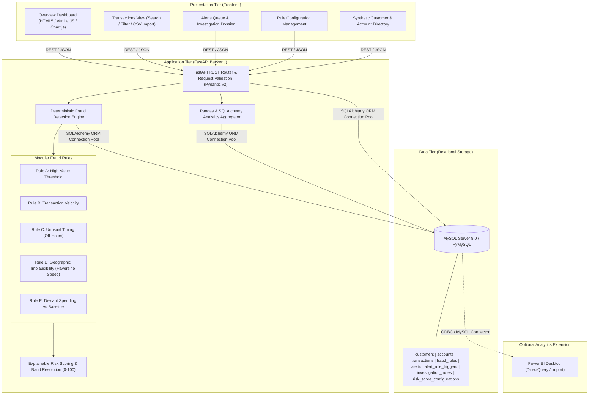

# System Architecture: Banking Transaction Monitoring & Fraud Risk Analysis

## 1. Architectural Overview

The **Rule-Based Banking Transaction Monitoring and Fraud Risk Analysis System** is structured following modern multi-tier architectural standards:

---

## 2. Component Breakdown

### 2.1 Presentation Tier (Frontend)
- **Zero-Build Stack**: Native HTML5, CSS3, and Vanilla JavaScript (ES6+). No complex node tooling (npm, webpack, Vite) required.
- **Chart.js 4.4+**: Client-side rendering of dynamic line, bar, doughnut, and pie charts bound directly to live backend REST API responses.
- **Responsive Layout**: Dual-tier sidebar navigation with desktop and laptop optimization.
- **Live State Management**: Single-page application (SPA) patterns for tab navigation, live status updates, modal inspection drawers, and toast alerts.

### 2.2 Application Tier (FastAPI Backend)
- **FastAPI**: High-performance Python 3.13-compatible ASGI web framework.
- **Pydantic V2**: Strict contract enforcement for incoming payload validation and outgoing response serialization.
- **Security & Integrity**:
  - Global CORS middleware restricted to local origins.
  - Parameterized SQLAlchemy queries preventing SQL Injection.
  - Global exception handlers preventing stack trace or credential leaks.

### 2.3 Rule-Based Fraud Detection Engine
- **Deterministic Evaluation**: Replaces non-transparent machine learning models with explainable mathematical and logical rules.
- **Configurable Parameters**: Rules read operational thresholds, time windows, and speed limits directly from the database or configuration file.
- **Auditability**: Every triggered rule generates an audit record in `alert_rule_triggers` detailing exact reasons, parameter thresholds, and contextual calculations.

### 2.4 Data Tier (MySQL Server 8.0)
- Fully normalized schema (3NF) maintaining relational integrity via Foreign Key cascades.
- Indexed timestamps, account identifiers, monetary amounts, and alert statuses for low-latency queries.
- Monetary amounts stored in high-precision `DECIMAL(15, 2)` format.
