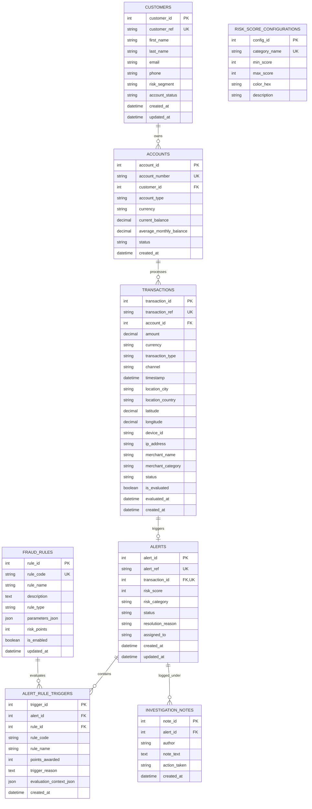

# Database Design & Entity Relationship Documentation

## 1. Relational Entity Overview

The system uses a normalized relational schema designed for MySQL 8.0, balancing 3NF normalization with rapid analytical querying.

---

## 2. Table Specifications

### 2.1 `customers`
- Stores synthetic personal and contact information.
- Primary Key: `customer_id` (INT AUTO_INCREMENT).
- Unique Key: `customer_ref` (e.g. `CUST-1001`).
- Segments: `STANDARD`, `LOW_RISK`, `HIGH_NET_WORTH`.

### 2.2 `accounts`
- Represents bank depository or credit accounts linked to a customer.
- Foreign Key: `customer_id` referencing `customers.customer_id` with `ON DELETE CASCADE`.
- Numeric Precision: `DECIMAL(15, 2)` for currency safety.

### 2.3 `transactions`
- Core ledger of synthetic financial activity.
- Foreign Key: `account_id` referencing `accounts.account_id` with `ON DELETE CASCADE`.
- Indexing Strategy:
  - Composite Index `(account_id, timestamp)` for rapid velocity and baseline lookups.
  - Index `(is_evaluated)` for filtering pending batches.
  - Index `(timestamp)` for time-series aggregation.

### 2.4 `fraud_rules`
- Stores rules and their dynamic parameters in a structured JSON column (`parameters_json`).
- Prevents hardcoding of rules inside application code.
- Configurable risk points (1 to 100) per rule.

### 2.5 `alerts`
- Generated whenever an evaluated transaction triggers one or more active fraud rules.
- Unique constraint on `transaction_id`: Prevents duplicate alerts for the same transaction evaluation.
- Risk Bands: `LOW`, `MEDIUM`, `HIGH`, `CRITICAL`.
- Lifecycle Statuses: `OPEN`, `UNDER_INVESTIGATION`, `RESOLVED`.

### 2.6 `alert_rule_triggers`
- Normalizes individual rule evaluations for an alert.
- Avoids storing messy delimited strings inside the `alerts` table.
- Stores `evaluation_context_json` providing full mathematical auditability (e.g. distance in km, implied speed, baseline mean).

### 2.7 `investigation_notes`
- Maintains a strict chronological audit trail of human risk analyst findings, actions taken, and status rationale.
- Foreign Key: `alert_id` referencing `alerts.alert_id`.

### 2.8 `risk_score_configurations`
- Defines continuous risk score thresholds (0-29 Low, 30-59 Medium, 60-79 High, 80-100 Critical) and hex colors.
